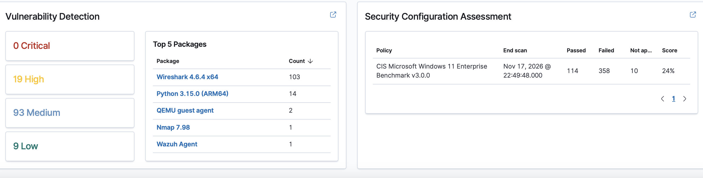
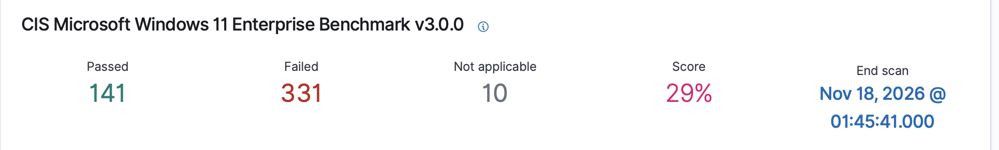

# Wazuh SOC Lab: detection engineering, vulnerability assessment and CIS hardening

> ⚠️ **Ethical Disclaimer.** All tests were run on virtual machines I own, in a lab network. Atomic Red Team runs real offensive techniques: do not use it on systems you do not own or without written authorization.

## 📌 Objective

Build a small home SOC and use it for three typical analyst tasks: check what a SIEM detects by default, write detection rules where coverage is missing, and measure the before/after of patching and hardening. Security+ topics involved: monitoring and logging, vulnerability management, hardening, the MITRE ATT&CK framework.

## 🧩 Context

- **Server**: Wazuh 4.14.1 all-in-one (manager, indexer, dashboard) on Ubuntu Server 24.04 ARM, UTM VM.
- **Endpoint**: Windows 11 Home (ARM, build 26200) with the Wazuh 4.14.1 agent and Sysmon.
- **Activity generator**: Atomic Red Team (Invoke-AtomicRedTeam 2.1.0).

## 🛠 Technologies and Tools

Wazuh (SIEM, Vulnerability Detection, SCA), Sysmon, Atomic Red Team, MITRE ATT&CK, CIS Microsoft Windows 11 Enterprise Benchmark v3.0.0, PowerShell, winget.

## ⚙️ What I Did

1. Installed Wazuh with the `wazuh-install.sh -a` script and connected the Windows agent.
2. Verified the pipeline with simple events (local user creation, failed logons): rules 60109, 60122, etc.
3. Installed Sysmon and connected its event channel to Wazuh.
4. Ran Atomic Red Team techniques one at a time, always with `-TestNumbers`, following the `-ShowDetailsBrief` → execution → `-Cleanup` cycle: T1033, T1082, T1087.001, T1069.001, T1016, T1049, T1057, T1053.005, T1547.001.
5. Looked in Wazuh at what each technique generated with the default rules and identified the coverage gaps (see Results).
6. Wrote 10 custom rules (IDs 100100-100109) in `rules/`, which extend Wazuh's Sysmon rules with command-line checks. I loaded them from the dashboard (Server management → Rules) and restarted the manager.
7. Re-ran the tests and compared the alerts before and after.
8. Ran the Vulnerability Detection scan, applied patches with `winget upgrade` and repeated the scan.
9. Used SCA (CIS Windows 11 Enterprise policy) to extract the failed checks, chose 27 safe checks (password and account lockout, registry keys, unneeded services), applied them with `net accounts` and `Set-ItemProperty` on the registry (also `Start=4` to disable services), and restarted the agent to force a new scan.

## 📊 Results

### Detection engineering

| Technique | Default rule | Custom rule |
|---|---|---|
| T1053.005 (scheduled task for persistence) | 92032, level 3, generic tag T1087 | **100100**, level 10 |
| T1016 (ipconfig/arp/nbtstat) | 92032, level 3 | **100101**, level 6 |
| T1049 (netstat) | 92032, level 3 | **100102**, level 6 |
| T1087.001 (`query user`) | 92052, level 4 | **100103**, level 6 |
| T1069.001 (local groups) | 92036/92031 (3), 92027 (4) | **100104**, **100105**, level 6 |
| T1057 (processes) | 92032 (3), 92027/92052 (4) | **100106-100108** (6), **100109** (8) |
| T1547.001 (Run key) | 92302, level 6, correct tag | no rule needed |

Without the custom rules, creating a scheduled task as SYSTEM at startup (T1053.005) produced only a level 3 alert with the wrong technique.

**False positives observed**
- Rule 92213 (level 15, T1105) fires on every PowerShell start: it flags an executable/script in `AppData\\Local\\Temp`.
- Rule 92041 (level 10) flagged the path `C:\\Path\\AtomicRedTeam.exe` as "Base64-like".
- Rule 92058 (level 12, `sdbinst.exe -m -bg`) turned out to be Windows maintenance activity.

**Limitations of the custom rules**
- They only read the command-line text: they do not cover obfuscated or Base64-encoded commands, or tools that use APIs without launching processes.
- The levels (6, 8, 10) are my own choice to make the events visible. On a real machine they would need tuning to avoid noise.

### Vulnerability Detection

| | Total | Critical | High | Medium | Low |
|---|---|---|---|---|---|
| Scan 1 | 121 | 0 | 19 | 93 | 9 |
| Scan 2 (after patching) | 16 | 0 | 7 | 8 | 1 |

- Wireshark 4.6.4 → 4.6.9: 103 CVEs closed (11 High).
- I also updated Python (3.15.0 → 3.15.2) and the QEMU guest agent; the QEMU package no longer appears in the results.

### CIS hardening (SCA)

| | Passed | Failed | Score |
|---|---|---|---|
| Before | 114 | 358 | 24% |
| After | 141 | 331 | 29% |

Comparing the export of failed checks before with the export of passed checks after shows exactly 27 checks moved to *Passed*, the same ones I had applied (list in `data/cis-controls-fixed.csv`). No other check changed.

**Limitation**: the benchmark is for Enterprise and the VM is Home. Many checks already pass because the feature is not installed, so the overall score does not measure real hardening. The meaningful figure is the delta of the 27 modified checks.

## 💡 What I Learned

- Wazuh's default Sysmon rules recognize the execution of `cmd.exe` or PowerShell, but assign generic techniques and levels: coverage of a specific ATT&CK technique must be verified with a test, not taken for granted.
- A child rule (`if_sid`) with a `pcre2` filter on the command line is enough to give the correct level and technique to a known behavior, but it can still be bypassed with obfuscation.
- Level 15 does not necessarily indicate an attack: a single overly broad rule (92213) can generate maximum-level alerts on every PowerShell start.
- Vulnerability scanning relies on the software inventory and version comparison: after a patch the inventory must be regenerated (agent restart) before re-running the scan.
- The SCA score depends on the system edition relative to the benchmark. It is better to report the changed checks, not just the percentage.

## 🔗 Links

- [Wazuh documentation](https://documentation.wazuh.com/)
- [Atomic Red Team](https://github.com/redcanaryco/atomic-red-team)
- [MITRE ATT&CK](https://attack.mitre.org/)
- [CIS Benchmarks](https://www.cisecurity.org/cis-benchmarks)
